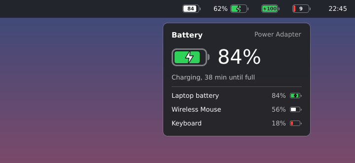

# macOS Battery untuk KDE Plasma 6

Widget baterai elegan bergaya macOS untuk KDE Plasma 6, lengkap dengan persentase.



*(Pratinjau; font dan warna mengikuti tema Plasma kamu.)*

## Fitur

- Ikon baterai ala macOS: outline tipis, kutub di kanan, isi yang mengikuti level baterai.
- Persentase di **dalam** baterai (gaya macOS terbaru, angka "terpotong" di bagian yang terisi), di **kiri** atau **kanan** baterai, atau disembunyikan.
- Ukuran bisa diatur: tinggi baterai, lebar baterai, dan ukuran teks persentase.
- Hijau saat mengisi daya, merah saat baterai lemah (bisa dimatikan), ikon petir saat dicas.
- Klik ikon untuk popup: persentase besar, status ("Charging, 38 min until full", "2 h 10 min remaining"), sumber daya, dan daftar perangkat lain yang punya baterai (mouse, keyboard, dll.).
- Bisa ditaruh di panel (horizontal/vertikal) maupun di desktop.
- Mengikuti tema terang/gelap Plasma.

## Kompatibilitas

- **KDE Plasma 6.0 ke atas** (Qt 6). Tidak untuk Plasma 5.
- Murni QML, tanpa kode C++ yang perlu dikompilasi, jadi jalan di distro apa saja yang memakai Plasma 6: **openSUSE Tumbleweed, openSUSE Leap 16**, Fedora KDE, Arch, KDE neon, Kubuntu 24.10+, Debian 13, dll.
- Data baterai diambil dari mesin `powermanagement` milik Plasma (lewat `org.kde.plasma.plasma5support`) yang sudah terpasang bersama Plasma Workspace, sama seperti sumber data widget baterai bawaan.

> openSUSE Leap 15.x masih memakai Plasma 5, jadi widget ini butuh Leap 16 atau Tumbleweed.

## Instalasi

### Cara 1: dari file `.plasmoid` (paling mudah)

1. Unduh `macos-battery-<versi>.plasmoid` (atau buat sendiri dengan `./build.sh`).
2. Klik kanan desktop atau panel → **Add Widgets…** (Tambah Widget).
3. Klik **Get New…** → **Install Widget From Local File…**, pilih file `.plasmoid` tadi.
4. Cari **macOS Battery** di daftar widget, lalu seret ke panel atau desktop.

Atau lewat terminal:

```bash
kpackagetool6 --type Plasma/Applet --install macos-battery-1.0.0.plasmoid
```

### Cara 2: dari source

```bash
git clone https://github.com/rifkiaz/macos-battery-kde.git
cd macos-battery-kde
./install.sh
```

`install.sh` otomatis melakukan upgrade kalau widget sudah pernah dipasang. Kalau `kpackagetool6` belum ada:

| Distro | Perintah |
| --- | --- |
| openSUSE Tumbleweed / Leap 16 | `sudo zypper install kf6-kpackage` |
| Fedora | `sudo dnf install kf6-kpackage` |
| Arch / Manjaro | `sudo pacman -S kpackage` |
| Debian / Ubuntu / KDE neon | `sudo apt install kpackagetool6` |

Setelah upgrade, muat ulang Plasma supaya versi baru terbaca:

```bash
systemctl --user restart plasma-plasmashell
```

### Menghapus

```bash
./uninstall.sh
# atau
kpackagetool6 --type Plasma/Applet --remove com.github.rifkiaz.macosbattery
```

## Pengaturan

Klik kanan widget → **Configure macOS Battery…**

- **Percentage**: Hidden / Left of the battery / Inside the battery / Right of the battery
- **Percentage text size**: ukuran teks persen di kiri/kanan (50–200%)
- **Battery height**: tinggi baterai, relatif terhadap ukuran otomatis panel (50–250%, tidak melebihi tebal panel)
- **Battery width**: lebar baterai dalam persen dari tingginya (140–350%, default 215%)
- **Reset size**: kembalikan ukuran ke default
- **Colors**: hijau saat mengisi, merah saat lemah
- **Low battery level**: batas "lemah" (default 20%)
- **Popup**: tampilkan perangkat lain (mouse, keyboard, …)

Tips: kalau mau tampilan persis macOS, sembunyikan widget baterai bawaan Plasma di System Tray (klik kanan System Tray → Configure → Entries → Power and Battery → *Disabled* atau *Always hidden*).

## Supaya muncul di "Get New Widgets" (KDE Store)

Dialog **Add Widgets → Get New… → Download New Plasma Widgets** mengambil daftar dari [store.kde.org](https://store.kde.org). Agar widget ini bisa diinstal langsung dari situ:

1. Jalankan `./build.sh` untuk membuat `macos-battery-<versi>.plasmoid`.
2. Login atau daftar di <https://store.kde.org> (akun KDE).
3. Klik **Add Product** (ikon `+` di pojok kanan atas).
4. Isi:
   - **Category**: pilih kategori widget untuk **Plasma 6** (di store namanya "Plasma 6 Applets" / widget di bawah "Plasma 6 Extensions"). Jangan kategori Plasma 5, karena dialog di Plasma 6 hanya menampilkan item Plasma 6.
   - **Title**: `macOS Battery`
   - **Description**, **License** (GPL-2.0-or-later), dan link ke repo GitHub ini.
   - Unggah gambar `docs/preview.png` (atau screenshot asli) sebagai gambar produk.
5. Di tab **Files**, unggah file `.plasmoid`.
6. Simpan/publish. Setelah tampil di store, widget bisa dicari dengan nama "macOS Battery" dari dialog Get New Widgets di desktop KDE mana pun.

Untuk rilis berikutnya: naikkan `Version` di `package/metadata.json`, jalankan `./build.sh`, lalu unggah file baru di halaman produk yang sama. Pengguna akan mendapat notifikasi update di dialog Get New Widgets.

## Struktur

```
package/
├── metadata.json                    # identitas widget (Plasma 6)
└── contents/
    ├── config/
    │   ├── main.xml                 # opsi konfigurasi
    │   └── config.qml               # halaman pengaturan
    └── ui/
        ├── main.qml                 # data baterai + status
        ├── CompactRepresentation.qml# tampilan di panel
        ├── FullRepresentation.qml   # popup / tampilan desktop
        ├── BatteryIcon.qml          # gambar baterai ala macOS
        ├── BatteryLabel.qml         # angka + petir di dalam baterai
        ├── Bolt.qml                 # ikon petir
        └── configGeneral.qml        # form pengaturan
```

Untuk mencoba tanpa memasang: `plasmoidviewer -a package` (paket `plasma-sdk`).

## Lisensi

GPL-2.0-or-later
